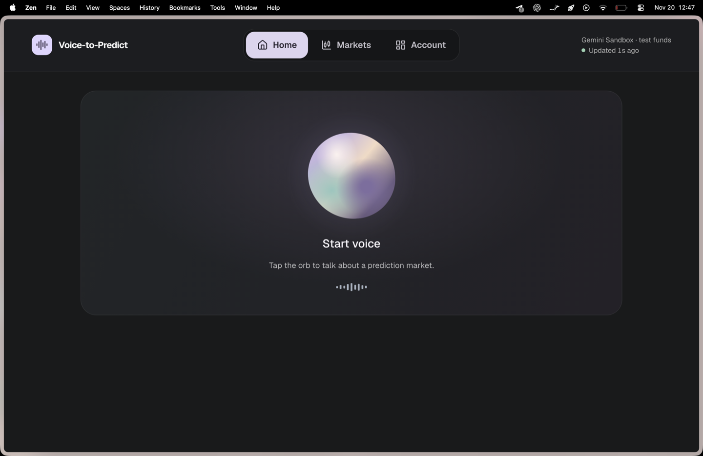
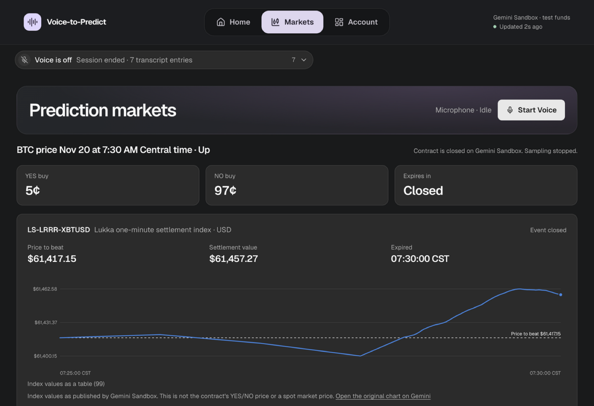
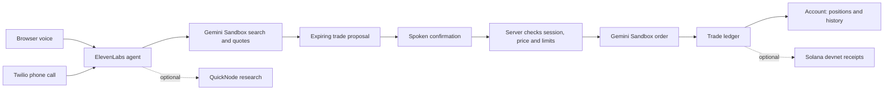

# Voice-to-Predict

Explore Gemini Sandbox prediction markets with an ElevenLabs voice agent. Ask for a market, hear the price of a YES or NO contract, and review the terms before confirming a trade. **All trades use sandbox test funds.** Public market browsing works without an account or API keys.

[Open the live app](https://voice-to-predict-ebon.vercel.app/) · [Browse markets](https://voice-to-predict-ebon.vercel.app/markets) · [How to use](#how-to-use)

| Start a voice session | Inspect a prediction market |
| --- | --- |
|  |  |

## How it works

| Capability | Details |
| --- | --- |
| Market data | Search active events and inspect fresh YES/NO quotes, spreads and available liquidity. The dashboard displays cents per contract. |
| Trading | Buy immediately with a price cap, set a limit in one-cent increments from 1¢ to 99¢, or sell held contracts. Immediate orders can fill partially. A limit buy can remain open. |
| Crypto research | View free market context. On supported assets, request a QuickNode research quote and approve payment separately in Arc testnet USDC. [Research and pricing](docs/quicknode-research.md) |
| Phone and receipts | A configured Twilio number reaches a dedicated ElevenLabs branch. Optional receipt anchoring uses a funded Solana devnet wallet. [Phone setup](docs/phone-calls.md) |
| Setup and deployment | Local trading uses SQLite. Hosted trading uses private storage and server-side credentials. Execution defaults off. [Setup, environment variables, API and troubleshooting](docs/setup-and-operations.md) · [Feature roadmap](feature-roadmap.md) |

## How to use

1. Open **Markets** and select a contract, or choose **Start voice** and say **“Find Bitcoin prediction markets.”**
2. Ask **“Show the order book for this contract.”** To investigate a supported crypto market, ask **“What would research on this market cost?”**
3. Try **“Buy 10 YES contracts at a limit of 42 cents.”** Review the contract, quantity, price, estimated fee and expiry. Confirm the exact terms in the same voice session to submit an eligible sandbox order.
4. Open **Account** to check fills, open orders and positions. To exit a holding, say **“Sell my entire position”** and review the new proposal. Hosted users share the demo sandbox account.

To run locally with Node 24.10 or newer, run `npm ci`, then `npm run dev`, and open [localhost:5173](http://127.0.0.1:5173).
